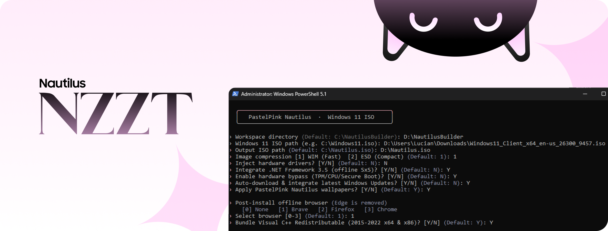

<h1 align="center">

Nautilus NZZT Experimental Source

---



</h1> 

Nautilus is a lightweight, standalone PowerShell all-in-one ISO builder that allows you to debloat, update Windows ISOs easily. **NZZT** is the next fork heavily based on [Nautilus](https://github.com/PastelPinkLab/Nautilus) and [tiny11maker](https://github.com/ntdevlabs/tiny11builder), compatible with **Windows 10, Windows 11, and LTSC / IoT LTSC** (Long-Term Servicing Channel).

## ⚠️ Disclaimer

> [!Warning]
> Great care went into making sure this script does not unintentionally break any OS functionality, but use at your own risk! This script modifies core system images offline. Always test your generated ISO on a Virtual Machine before deploying it on your main hardware.

> This script in this repo is experimental. If you're looking for the main repo, take a look at this [link](https://github.com/PastelPinkLab/Nautilus_NZZT).

---

## ✨ Key Features

### Flexible Windows 11/10 supports and auto-converting ESD to WIM
* **Windows 11/10 Compatibility:** Automatically detects **Windows 10**, **Windows 11**, and **LTSC / IoT LTSC** (`EnterpriseS`, including LTSC 2019 `ReleaseId` builds).
* **ESD-to-WIM Conversion:** Automatically convert `install.esd` images for your edition index into a writable `install.wim`.
* **Compression Options:** Export final install images as **WIM (Max)** for faster builds or **ESD (Recovery)** for maximum space savings.
* **Dual-Boot ISO Generation:** Automatically fetches oscdimg from the Microsoft Symbol Server to build a bootable BIOS + UEFI ISO (`UDF v1.02`), complete with a `.sha256` checksum and a `.report.txt` for build summary.

### Payloads
* **Auto-LCU (Windows Update Integration):** Dynamically queries the Microsoft Update Catalog to download, cache (`NautilusUpdatesCache`), and scan the latest x64 Servicing Stack & Cumulative Updates (supports 25H2/24H2 shared servicing base, optional Preview builds, and Windows 10 22H2 ESU updates).
* **Smart Driver Injection:** Inject drivers from a custom folder or auto-export third-party drivers from your running host OS (`Export-WindowsDriver`). Boot-critical classes (`SCSIAdapter`, `HDC`, `Volume`, `USB`, `Net`, `HIDClass`, `Mouse`, `Keyboard`, `System`) are automatically filtered into `boot.wim` (WinPE), while all drivers are injected into `install.wim`.
* **Offline .NET Framework 3.5:** Integrates `NetFx3` offline directly from `sources\sxs` and erases the redundant `sxs` folder afterward.
* **Windows 11 Hardware Bypass:** Bypasses TPM 2.0, CPU, RAM, Secure Boot, and Storage checks across both `install.wim` and `boot.wim` (including clearing `appraiserres.dll` and hiding unsupported hardware watermarks).

### Post-Install
* **Offline Browser Bundling:** Optionally downloads and stages standalone offline installers into `sources\$OEM$\$$\Setup\Scripts` for **Brave** (Standalone via GitHub API), **Firefox** (Offline x64), or **Chrome** (Enterprise MSI) (P/S: We will add more).
* **Visual C++ Redistributable:** Optionally bundles **VC++ Redistributable 2015–2022 (x64 & x86)** for installation.
* **OEM-Key Safe Execution:** Runs via `SetupComplete.cmd` with an automatic `FirstLogonCommands` fallback so devices with embedded BIOS product keys still receive post-install packages and cleanup.
* **Nautilus Wallpapers:** Optionally downloads and replaces default 4K/standard desktop wallpapers (`img0.jpg`, `img19.jpg`) and lock screen wallpaper (`img100.jpg`).

---

## 🧹 What Gets Removed & Kept

#### Provisioned UWP / AppX Packages (Allowlist-Based)
* `Microsoft.WindowsStore`, `Microsoft.StorePurchaseApp`, `Microsoft.Services.Store.Engagement`
* `Microsoft.DesktopAppInstaller` (Winget)
* `SecHealthUI` (Windows Security — automatically re-registered at first logon on Windows 11)
* `Microsoft.VCLibs`, `Microsoft.UI.Xaml`, `Microsoft.NET.Native`, `Microsoft.WindowsAppRuntime`
* Media Extensions: `AV1`, `AVC`, `HEIF`, `HEVC`, `MPEG2`, `VP9`, `WebMedia`, and `WebP`

#### Optional Features & Capabilities (FOD)
* **Optional Features:** `Recall`, `Internet-Explorer-Optional-amd64`, Internet Printing Client, XPS Services, Print to PDF, `WorkFolders-Client`, `SMB1Protocol` (Client/Server/Deprecation), `WCF-Services45`, `SmbDirect`, `MicrosoftWindowsPowerShellV2` (and Root), `MSRDC-Infrastructure`.
* **Capabilities (FOD):** `App.StepsRecorder`, `App.Support.QuickAssist`, `Browser.InternetExplorer`, `MathRecognizer`, `Microsoft.Wallpapers.Extended`, `Microsoft.Windows.PowerShell.ISE`, `Microsoft.Windows.WordPad`, `OneCoreUAP.OneSync`, `Print.Fax.Scan`, `Print.Management.Console`, `WMI-SNMP-Provider`, `Language.Handwriting`, `Language.OCR`, `Language.Speech`, `Language.TextToSpeech`, `Rsat.*`, and `VBSCRIPT`.

#### Hidden CBS Packages (Unlocked via Privilege Escalation)
After running `DISM /StartComponentCleanup /ResetBase` to keep WinSxS clean, Nautilus uses a built-in C# `TokenManipulator` (`SeTakeOwnershipPrivilege`, `SeRestorePrivilege`, `SeBackupPrivilege`) to unhide and purge 70+ hidden CBS packages (while protecting `RollupFix`, `ServicingStack`, `DotNetRollup`, `KB`, and `EKB` updates):

* **Core bloat:** OneDrive Setup, Internet Explorer / Browser packages, Windows Copilot, Windows Recall & AIX, Outlook/FlipGrid PWAs, CEIP, Extended Wallpapers, WordPad, Quick Assist, Steps Recorder, Remote Assistance, XPS/Fax, Retail Demo, OpenSSH Server, Edge DevTools Client.
* **Enterprise leftovers:** Holographic Desktop (Windows Mixed Reality), Application Guard / HVSI, WMP Network Sharing, App-V, UE-V, ADAM Directory Services, MSMQ, IIS WebServer, DataCenter Bridging, PeerDist, Offline Files, Host Guardian / Shielded VM, SimpleTCP, Telnet/TFTP Clients, NFS Client, Embedded/IoT packages.

#### Browser, Cloud & Shell Cleanup
* **Edge & OneDrive:** Purges Microsoft Edge, EdgeUpdate, EdgeCore, Edge WebView2 (`DISM /Remove-Edge` + forced directory cleanup), `OneDriveSetup.exe` (System32 & SysWOW64), and orphaned Default App Associations (`MicrosoftEdge`, `Zune`, `Bing`, `Xbox`).
* **Dead SystemApps:** Removes `PeopleExperienceHost`, `ParentalControls`, `NarratorQuickStart`, `CallingShellApp`, and `ECApp`.
* **ISO Debloating:** Strips `support`, `sources\migwiz`, and `sources\sxs` (when .NET 3.5 is integrated) before packaging.

---

## ⚙️ System Tweaks & Hardening

* **OOBE & Local Accounts:** Enables `BypassNRO`, skips Wi-Fi setup.
* **Privacy & IFEO Telemetry Blocking:** Disables Telemetry (`AllowTelemetry = 0`), Advertising ID, Tailored Experiences, and Online Speech/Inking/Typing data collection.
* **AI, Search & Taskbar:** Disables Windows Copilot, Recall & AI data analysis, Bing web search, Dynamic Search Highlights, News & Interests/Feeds, Chat icon, Widgets, Start Iris recommendations, and default Start Menu pins.
* **System & QOL:** Disables BitLocker, Hibernation, Reserved Storage, Delivery Optimization, global background UWP apps, Sticky Keys, and Explorer folder-type discovery (`UsrClass.dat`). Unlocks DMA Region Policy (`IntegratedServicesRegionPolicySet.json`).
* **Forced App Blocking:** Preventing Windows Update/OOBE from silently installing Outlook, DevHome, Teams, and Windows Mail.
* **Services & Scheduled Tasks:** Disables 16 unnecessary background services (`SysMain`, `DiagTrack`, `UCPD`, `TrkWks`, `MapsBroker`, `wisvc`, `RemoteRegistry`, `GameBarPresenceWriter`, etc.) and deletes 15 telemetry scheduled tasks (`Microsoft Compatibility Appraiser`, `UCPD velocity`, `CEIP`, `WinSAT`, `QueueReporting`, etc.).

---

## So... how to use the builder?

### Requirements
- A pure Windows 11 ISO downloaded from Microsoft.
- At least 20GB of free space on your `C:\` drive for the workspace.
- **Administrator Privileges** (The script will automatically check for this).

### Running the Script

1. Download the latest version of the script (`NautilusBuilder.ps1`).
2. Open PowerShell as Administrator.
3. Temporarily allow script execution by running:
   ```PowerShell
   Set-ExecutionPolicy Unrestricted -Scope Process -Force
5. Run the scripts (e.g. C:\NautilusNZZT.ps1)
5. Follow the instructions
6. Sit back and let the tool do it

## License
- Not available

## Credits
- [NTDEV](https://github.com/ntdevlabs) for creating and hosting Tiny11Builder
- [Luu Phuong](https://github.com/lyghtlychee) for providing some neccessary infos
- [Raphire](https://github.com/Raphire) for Win11Debloat
- ...

## Support me
- Non-available, unfortunately
